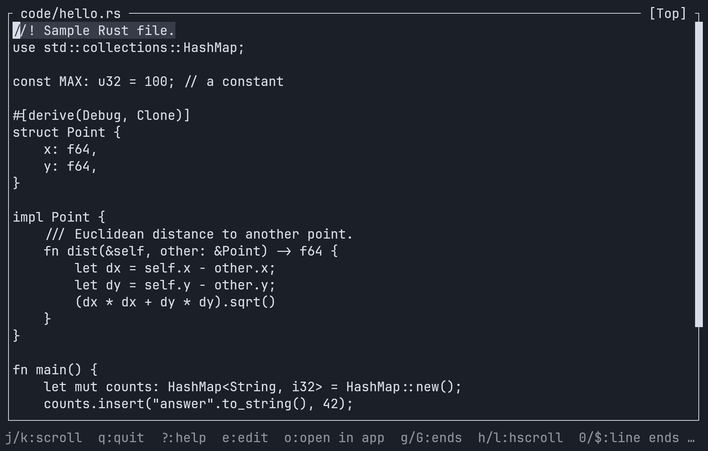

# konoma-code

Source code and config files for [konoma](https://github.com/LESIM-Co-Ltd/konoma), a terminal file
browser: the `code` plugin and the syntax highlighting library behind it.



| Crate | What it is |
|---|---|
| [`konoma-code`](crates/konoma-code/README.md) | The `code` plugin, and a standalone program that opens one file |
| [`konoma-code-core`](crates/konoma-code-core/README.md) | Syntax highlighting into `ratatui` lines (syntect + two-face) |

konoma already includes the plugin, so konoma users have nothing to install from here. Syntax
colors appear inside konoma; the standalone program currently shows
[plain text](crates/konoma-code/README.md#standalone-program).

## Try it

From a clone of this repository:

```sh
cargo run -- samples/code/hello.rs
```

Press `?` for the keys and `q` to quit. `samples/code/` holds one small file per language and a
large one (`large_generated.rs`). Its `README.md` is copied from konoma and describes konoma's
behaviour; the standalone program opens single files, not the folder.

## Build and test

Rust 1.92 or newer. CI runs on macOS and Linux, with and without default features.

```sh
cargo build
cargo nextest run
cargo test --doc
cargo nextest run --no-default-features
```

On Ubuntu, CI first installs `pkg-config cmake libssl-dev zlib1g-dev`.

## License

[MIT](LICENSE)
