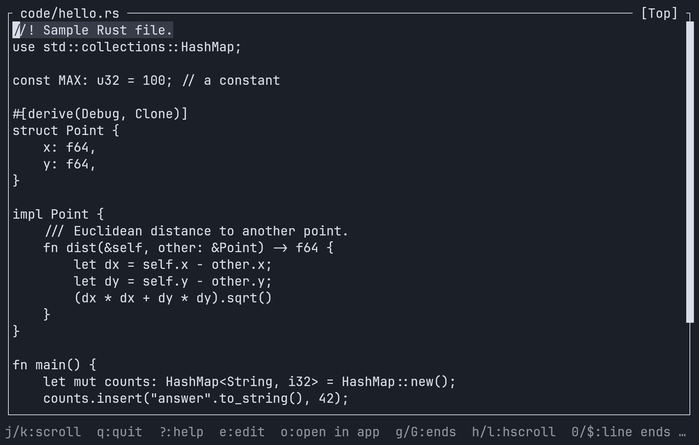

# konoma-code

The `code` plugin of [konoma](https://github.com/LESIM-Co-Ltd/konoma): source and config files
shown as text, with syntax colors from
[`konoma-code-core`](https://github.com/LESIM-Co-Ltd/konoma-code/tree/main/crates/konoma-code-core).



## Files

By default the plugin takes these extensions, ignoring case:

`rs` `ts` `tsx` `js` `py` `go` `toml` `json` `sh` `yaml` `yml` `c` `cpp` `h`

## With konoma

konoma has this plugin built in; there is nothing to install. `konoma --plugins` lists it.

- `konoma plugin install konoma-code` is refused: the crate is already part of konoma.
- Pointing konoma at the standalone program (`--plugin`) does not replace the built-in plugin:
  konoma does not load a second plugin with the id `code`.
- `[plugins.code] enabled = false` in konoma's config turns the built-in plugin off.

## Standalone program

```sh
cargo install konoma-code
```

**It shows plain text, without syntax colors.** The plugin supplies the colors, but the standalone
host in `konoma-plugin` 0.1.0 does not apply them to a file. Use konoma to read highlighted code.

```text
konoma-code <file>        show a file in the terminal
konoma-code --help, -h    print usage
konoma-code --version     print the plugin id and version
konoma-code --manifest    print the plugin's declarations as JSON
konoma-code --serve       speak the plugin protocol on stdin/stdout (for a host program)
```

`--plugin code` may be given as well; it is the only plugin in the program. `<file>` is one file
with an extension listed above. Directories and other files (`Makefile`, `README.md`, ...) are
refused. Showing a file needs a terminal on standard input and output, but no graphics protocol.

### Keys

A file is shown with a caret, the cell in reverse video. A "line" below is a line of the file, even
when it is wrapped over several rows. With wrapping off, the view follows the caret down, up and
sideways. With wrapping on (the default), the view moves by lines of the file rather than screen
rows, so with long lines the caret can go below the screen and the end of the file can stay out of
view; turn wrapping off (`,` then `w`) to see it.

| Key | Action |
|---|---|
| `j` `k`, `↓` `↑` | Move the caret down / up one line |
| `g` `G`, `Home` `End` | Move the caret to the first / last line |
| `h` `l`, `←` `→` | Move the caret one character left / right |
| `0` `$` | Move the caret to the start / end of the line |
| `Ctrl-f` `Ctrl-b`, `PageDown` `PageUp` | Page down / up |
| `Ctrl-d` `Ctrl-u` | Half page down / up |
| `y` then `n` `r` `f` `p` `@` | Copy to the clipboard: name, relative path, full path, parent, `@` reference |
| `,` then `w`, or `Space` `w` | Toggle wrapping |
| `,` then `p`, or `Space` `d` | Cycle how the title writes the path: relative, from home (`~`), full |
| `e` | Open the file in your editor |
| `o` | Open the file with the operating system's default application |
| `?` | Help |
| `q`, `Esc`, `Q`, or `Space` `c` | Quit |

With `[ui] keys = "less"`, page and half-page movement are `f` `b` and `d` `u` without `Ctrl`.

`Space` opens a menu with some of these actions. There is no search, no range selection and no line numbers.

### Configuration

The program reads konoma's config file, `$XDG_CONFIG_HOME/konoma/config.toml`, if there is one.
For example:

```toml
[ui]
lang = "en"      # "auto", "en" or "jp"
keys = "less"    # f b d u instead of Ctrl-f Ctrl-b Ctrl-d Ctrl-u
wrap = false
tab_width = 4

[editor]
command = "nvim" # otherwise $VISUAL, then $EDITOR, then vim
```

Known editors such as vim open at the cursor line. For another editor, put `{line}` (and optionally
`{path}`) in the command. The plugin's own settings, `[plugins.code] syntax_highlight` and
`[ui.theme] code_theme`, change the colors inside konoma and have no visible effect here.

## As a library

`CodePlugin`, `code_manifest()` and `CODE_ID` describe the plugin; `CodeStyler` colors a block of
lines; `plugins()` returns what the program carries. The default feature `app` builds the standalone
program; use `default-features = false` to depend on the plugin alone.

MIT licensed.
